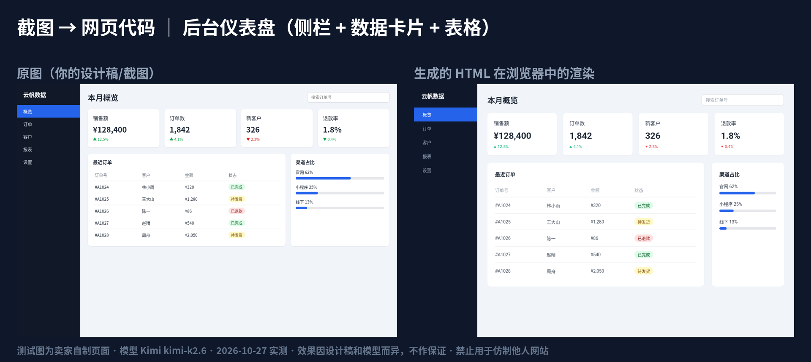
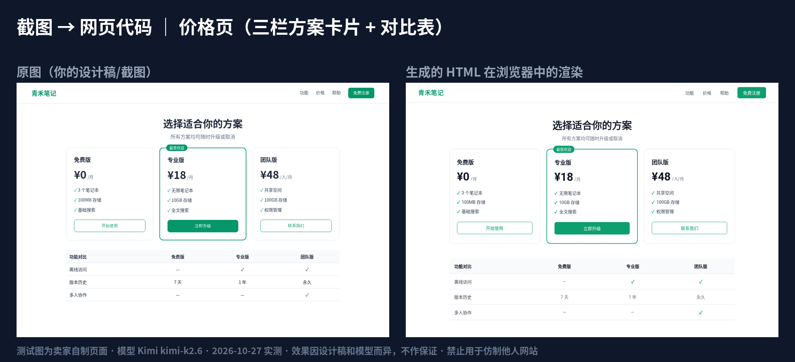
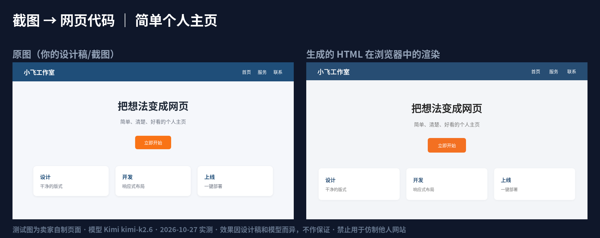

# 海外AI工具周报 · AIToolWeekly

> 💡 **screenshot-to-code 中文社区版整合包（爱发电，¥29.9）**：https://afdian.com/item/e896ee28d1b311f18c5752540025c377
> - 买到什么：基于开源项目 abi/screenshot-to-code 整理的交付包——中文界面汉化；国内模型适配（新增 Chat Completions 接口，默认 Kimi，备选硅基流动）；Windows/Mac/Linux 一键启动脚本（仅 Linux 实测）；中文教程 4 篇 + FAQ；爱发电私信答疑。不含任何 API Key 或模型额度，Key 需自备、费用自付；不承诺生成效果。
> - 价格：¥29.9。
> - 怎么拿：付款后私信，24 小时内人工发送下载链接；链接打不开可私信我要备用网盘链接。
> - 原项目 MIT 协议，作者 Abi Raja；我们不是原作者，本包为非官方社区版，与原作者无关。
> - 登录爱发电后可看完整商品说明。
> - 支持主页：https://afdian.com/a/AIToolWeekly

这个仓库放两样东西：
1. **海外AI工具周报**：每期挑选当周新出的海外（也收少量国内）AI 工具，用中文总结，每条都附原始出处。见 [`weekly/`](weekly/)。
2. **screenshot-to-code 中文社区版**：开源项目 screenshot-to-code 的中文汉化 + 国内模型适配。本仓库只放说明、教程、FAQ 和实测对比图，见 [`docs/screenshot-to-code/`](docs/screenshot-to-code/)。

---

## 一、海外AI工具周报
| 期数 | 日期 | 文件 |
|---|---|---|
| 第 1 期 | 2026-10-27 | [weekly/2026-10-27_第1期.md](weekly/2026-10-27_第1期.md) |
| 第 2 期 | 2026-11-02 | [weekly/2026-11-02_第2期.md](weekly/2026-11-02_第2期.md) |

- 每条都附官方原文或报道链接；只来自搜索摘要、没能在原文里读到的信息标为【二手】。
- 第 1、2 期所有条目**均未实测**。价格、功能和可用性随时会变，请以官方页面为准。
- 不附任何推广链接。

## 二、screenshot-to-code 中文社区版（非官方）

[screenshot-to-code](https://github.com/abi/screenshot-to-code) 是 **Abi Raja** 开发的开源项目（**MIT 协议**，Copyright (c) 2023 Abi Raja）：上传网页截图或设计稿，让 AI 生成 HTML 代码。感谢原作者！

中文社区版是我们基于它做的**非官方**修改版，与原作者无关：
- 中文界面、中文报错提示，AI 的说明文字默认用简体中文
- 新增 **Chat Completions 接口支持**（原版只支持 OpenAI Responses 接口），可以接国内模型
- 设置页一键预设，默认只生成 1 个版本、不自动重试，省额度
- Windows / Mac / Linux 一键启动脚本，含中文教程和 FAQ

### 支持的模型
| 服务商 | 模型 | 状态 |
|---|---|---|
| **Kimi（默认）** | `kimi-k2.6` | 2026-10-27 实测：3 张测试图都生成出了页面 |
| **硅基流动（备选）** | `Qwen/Qwen3-VL-32B-Instruct` | 实测能出页面，但较慢（2–5 分钟），还原度不如 Kimi |
| DeepSeek | — | **暂不支持**（未能实测） |

模型 Key 需要你自己申请，费用由你和模型平台结算。

### 实测对比（左：原图；右：生成的 HTML 在浏览器里的渲染）
测试图都是我们自己写的虚构页面，不是任何真实网站。模型：Kimi `kimi-k2.6`，2026-10-27。

**后台仪表盘**（侧栏 + 数据卡片 + 表格）

**价格页**（三栏方案卡片 + 对比表）

**简单个人主页**

只测了这 3 张图，字号、间距和原图仍有偏差。

### 已测试 / 未测试
- 已测试：Linux 一键启动；浏览器里的预设、Key 遮挡、Key 不写入浏览器存储
- 未测试：**Windows、Mac 启动脚本没有真机测试**；阿里云百炼预设没有实测

### 重要声明
- **非官方**：本项目不是 screenshot-to-code 官方版本，与原作者 Abi Raja 无关。
- **不承诺效果**：生成效果取决于模型和你的设计稿，不承诺任何效果、成功率或速度。
- **禁止抄袭**：**禁止用来抄袭、复制他人的网站或设计**；只能用于你自己的设计稿或已获授权的素材。
- 教程见 [`docs/screenshot-to-code/`](docs/screenshot-to-code/)；上游 MIT 许可原文见 [`docs/screenshot-to-code/UPSTREAM_LICENSE_screenshot-to-code.txt`](docs/screenshot-to-code/UPSTREAM_LICENSE_screenshot-to-code.txt)。

---

> 💡 **screenshot-to-code 中文社区版整合包（爱发电，¥29.9）**：https://afdian.com/item/e896ee28d1b311f18c5752540025c377
> - 买到什么：基于开源项目 abi/screenshot-to-code 整理的交付包——中文界面汉化；国内模型适配（新增 Chat Completions 接口，默认 Kimi，备选硅基流动）；Windows/Mac/Linux 一键启动脚本（仅 Linux 实测）；中文教程 4 篇 + FAQ；爱发电私信答疑。不含任何 API Key 或模型额度，Key 需自备、费用自付；不承诺生成效果。
> - 价格：¥29.9。
> - 怎么拿：付款后私信，24 小时内人工发送下载链接；链接打不开可私信我要备用网盘链接。
> - 原项目 MIT 协议，作者 Abi Raja；我们不是原作者，本包为非官方社区版，与原作者无关。
> - 登录爱发电后可看完整商品说明。
> - 支持主页：https://afdian.com/a/AIToolWeekly
